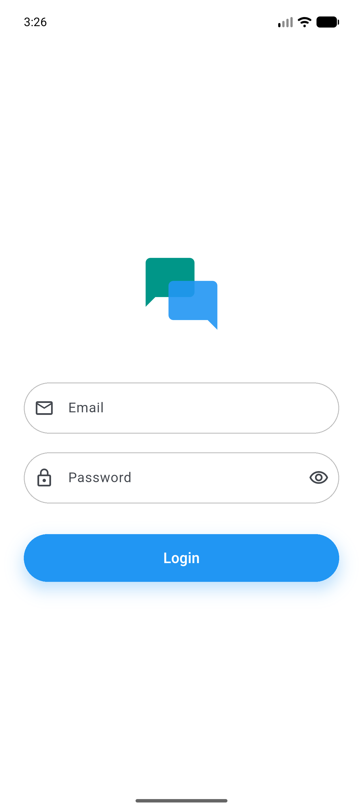
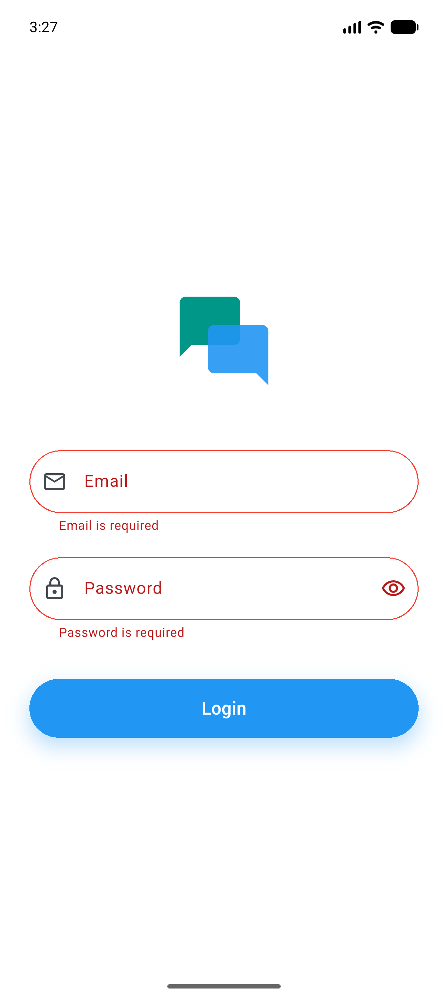
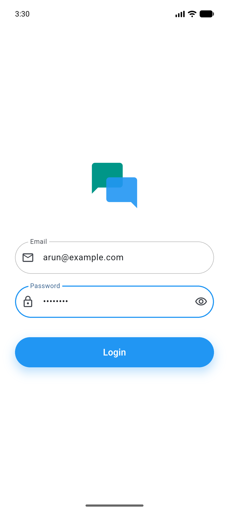
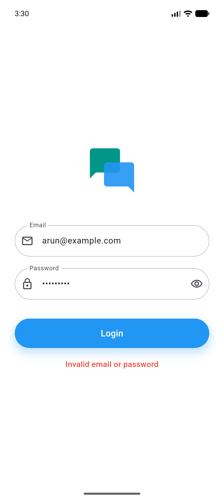
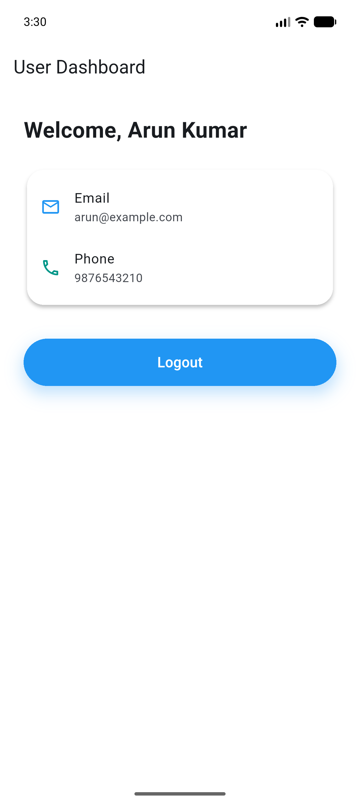

# Experiment 10: User Authentication using Firestore

URK23CS5014 - 24CS2016 Building Applications using Flutter

## Aim

To develop a Flutter application that implements a user login system by validating email and password credentials stored in Google Cloud Firestore, with proper validation and a professional user interface.

## Features

- The app never adds, updates or deletes users. It only reads the `users` collection.
- Clean login screen with a chat-bubble logo built from Flutter widgets, pill-shaped fields and a rounded blue button.
- Validation under each field: email required and valid, password required and at least 6 characters.
- The Login button shows a spinner and is disabled while checking.
- The user is fetched with `where('email', isEqualTo: ...)` from the server. The app then hashes salt + entered password with SHA-256 and compares it with the stored hash.
- A valid login opens the dashboard with `Welcome, <name>`, the email and the phone. Logout returns to the login screen and Back cannot return to the dashboard.
- A wrong password and an unknown email show the same message: `Invalid email or password`.
- Network and permission errors show a readable message.

## How the users collection was created

The users were added outside the Flutter app, in the existing `urk23cs5014-flutter-exp7` Firebase project:

1. A temporary rule allowing writes to `users` was deployed.
2. `tools/seed_users.py` was run once. It calls the Firestore REST API, lets Firestore generate each Document ID, and skips emails that already exist. Each user gets a random 16-byte salt, and only the SHA-256 hex of salt + password is stored.
3. The rule was closed straight away and deployed again.

`tools/verify_rules.py` proves the result with REST calls: a write to `users` returns 403 and a read returns the 4 users with hashed passwords.

## Security rules

This app shares the Firebase project with Experiments 7, 8 and 9. A deploy replaces the whole rules file, so `firestore.rules` is identical in all four repos.

| Collection | Read | Create | Update | Delete |
| --- | --- | --- | --- | --- |
| `employees` | Until 30 Nov 2026 | Until 30 Nov 2026 | Until 30 Nov 2026 | Until 30 Nov 2026 |
| `books` | Yes | No | `copies` only, whole number from 0 to 1000 | No |
| `users` | Yes | No | No | No |

Read on `users` stays open because this lab logs in by reading Firestore directly instead of using Firebase Authentication.

## Demo login

Fake demo accounts, also listed in `tools/demo_credentials.md`.

| Email | Password |
| --- | --- |
| arun@example.com | Arun@123 |
| priya@example.com | Priya@123 |
| rahul@example.com | Rahul@123 |
| sneha@example.com | Sneha@123 |

## How to run

```
flutter pub get
flutter run
flutter test
```

To check the rules, run `python tools/verify_rules.py` (needs the `requests` package).

## Screenshots

| Login screen | Validation errors | Login details entered |
| --- | --- | --- |
|  |  |  |

| Invalid email or password | User dashboard | After logout |
| --- | --- | --- |
|  |  |  |

## Note for real apps

This login exists for the lab. Anyone can read the `users` collection, including the salts and hashes, and a client-side check can be bypassed. Real apps should use Firebase Authentication instead of storing passwords in Firestore.
